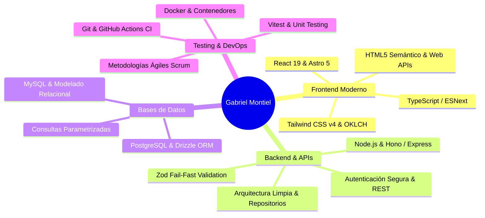

# 👋 ¡Hola, soy Gabriel Montiel (`Gabmon24`)!

### 🎓 Licenciado en Informática | 🚀 Tecnólogo en Análisis y Desarrollo de Software (ADSO - SENA)
**📍 Colombia (UTC-5) · 🌐 Open to Remote Software Engineering Roles Worldwide**

  Ingeniero de software y educador en ciencias de la computación. Me especializo en la construcción de aplicaciones web de alto rendimiento, arquitecturas de backend limpias y sistemas desacoplados con <strong>TypeScript estricto</strong>, <strong>pruebas automatizadas</strong> y estándares de producción.

---

## 🚀 Proyectos Destacados (Featured Engineering)

### 🏋️ [Proyecto Gym — Colombian Fitness Management OS](https://github.com/Gabmon24/proyecto-gym)
> Sistema operativo integral de gestión y control diseñado para la economía real de gimnasios en Colombia (tarifas en COP, pagos locales por Nequi/Daviplata, arqueo de caja con control de descuadres, carnet digital con código QR dinámico y audio-feedback estilo torniquete con Web Audio API).

- **Arquitectura:** Clean Architecture modular (Frontend desacoplado de la API y persistencia).
- **Stack:** Astro 5, React 19, Tailwind CSS v4 (OKLCH), Hono (TypeScript), PostgreSQL, Drizzle ORM.
- **Calidad & Testing:** 19 pruebas unitarias automatizadas con **Vitest** (100% passing).
- 🔗 **[🚀 Probar Demo en Vivo en Vercel](https://proyecto-6bxqv16ow-gabmon24.vercel.app)** · 📁 **[Ver Código en GitHub](https://github.com/Gabmon24/proyecto-gym)**

---

### 🩺 Sistema de Gestión de Citas Médicas (Full-Stack)
> Sistema integral de agendamiento y expedientes clínicos con control de acceso basado en roles (RBAC), modelo relacional de datos de alta integridad y autenticación segura con JWT.
- **Stack:** Node.js, Express, PostgreSQL / MySQL, Docker, RESTful API.
- **Enfoque:** Arquitectura en capas, principios SOLID y persistencia relacional.

---

## 🛠️ Stack Técnico & Competencias Principales

---

## 📊 Actividad & Estadísticas

  
  

---

## 📫 Conéctate conmigo

- 💼 **LinkedIn:** [linkedin.com/in/gabriel-montiel](https://www.linkedin.com/in/gabriel-montiel-5239801a9)
- 🐙 **GitHub:** [github.com/Gabmon24](https://github.com/Gabmon24)
- 💬 **Disponibilidad:** Contratación remota (Full-time / Part-time / Contract)

> *"La educación en informática y el desarrollo de software tienen el mismo objetivo: resolver problemas reales y transformar entornos a través de la tecnología."*
